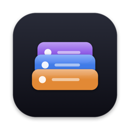
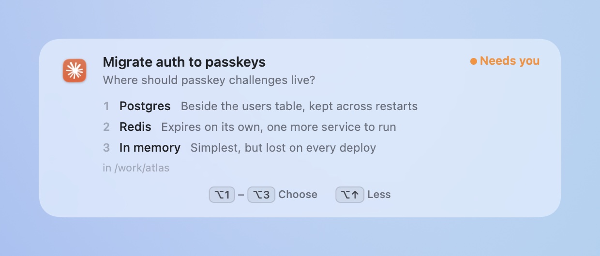
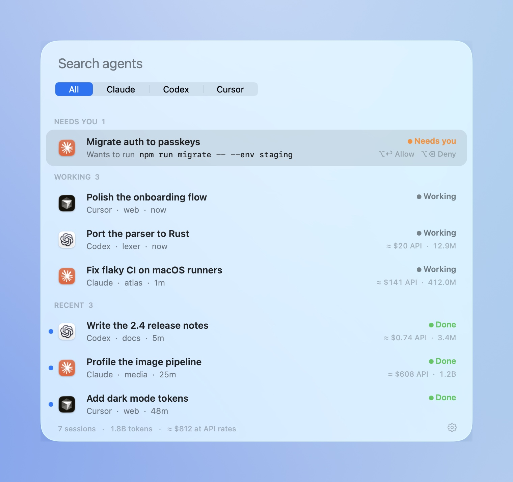

<p align="center">
  
</p>

<h1 align="center">Muster</h1>

<p align="center">
  <b>Never keep an agent waiting.</b><br>
  A free, open-source Mac menu bar app for your Claude Code, Codex and Cursor sessions.
</p>

<p align="center">
  <a href="https://github.com/josefchen/muster/releases/latest/download/Muster.dmg"><b>Download for Mac</b></a> ·
  <code>brew install --cask josefchen/tap/muster</code> ·
  <a href="https://agentmuster.app">agentmuster.app</a> ·
  <a href="CHANGELOG.md">Changelog</a>
</p>

<p align="center">
  <picture>
    <source media="(prefers-color-scheme: dark)" srcset="docs/media/answer-dark.gif">
    
  </picture>
</p>

<p align="center"><sub>Two agents ask. <kbd>⌥</kbd><kbd>↓</kbd> shows why, two presses of <kbd>⌥</kbd><kbd>↩</kbd> answer them, and you never left what you were doing. Recorded from the app.</sub></p>

If you run a few coding agents at once, the slow part isn't the agents. It's noticing which one has been waiting on you for ten minutes. Muster sits in the menu bar, tells you the moment one needs you, and lets you answer without switching apps.


<table>
<tr>
<td width="50%" valign="top">

**See who needs you.**<br>
A glass alert at the top of the screen the moment an agent waits on you. It stays until you answer.

</td>
<td width="50%" valign="top">

**Answer from anywhere.**<br>
Allow a command or pick an answer with <kbd>⌥</kbd><kbd>↩</kbd>, or right from the notification. The alert shows its keys.

</td>
</tr>
<tr>
<td valign="top">

**See why before you answer.**<br>
<kbd>⌥</kbd><kbd>↓</kbd> unfolds the agent's reason, the whole command, or every option with its note.

</td>
<td valign="top">

**Your keys stay yours.**<br>
Muster takes its keys only while something on screen needs them, and lets go while you type elsewhere.

</td>
</tr>
<tr>
<td valign="top">

**<kbd>⌥</kbd><kbd>Tab</kbd> to any agent.**<br>
Most urgent first. Let go to land in its window, or the terminal it runs in.

</td>
<td valign="top">

**Find any session.**<br>
<kbd>⌃</kbd><kbd>⌥</kbd><kbd>Space</kbd> searches the last three hours, with tokens and API-rate cost for each.

</td>
</tr>
</table>

<p align="center">
  <picture>
    <source media="(prefers-color-scheme: dark)" srcset="docs/media/peek-dark.jpg">
    
  </picture>
</p>

<p align="center">
  
</p>

<p align="center">
  <picture>
    <source media="(prefers-color-scheme: dark)" srcset="docs/media/deck-dark.jpg">
    
  </picture>
</p>

<p align="center"><sub>Native AppKit and Liquid Glass · 2 MB download · about 0.4% CPU and 20 MB of memory with ten agents busy · no accounts, no analytics · MIT</sub></p>

<br>

## Install

**[Download Muster.dmg](https://github.com/josefchen/muster/releases/latest/download/Muster.dmg)** and drag it to Applications, or:

```bash
brew install --cask josefchen/tap/muster
```

macOS 14 or later, Apple silicon or Intel. Liquid Glass needs macOS 26.

## Answer prompts from Muster

Turn it on per agent in **Settings → Answer prompts from Muster**.

| | What you can answer |
|---|---|
| **Claude Code** | Permission requests, multiple-choice questions, plan approvals |
| **Codex** | Approval requests (trust the hook once with `/hooks` in Codex) |
| **Cursor** | Opens the prompt in Cursor |

Muster adds one hook to the agent's own settings and removes exactly that when you turn it off. Beside the file it keeps `.muster-original`, the file as it was before Muster first changed it, and `.muster-backup`, the file before the latest change. A symlinked settings file stays a link, and a file Muster can't parse is left alone. Claude's native dialog stays live alongside Muster, and the first answer wins. If Muster isn't running, the agent asks as usual. Hooks talk to Muster on `127.0.0.1` with a per-install token.

## Shortcuts

| Keys | |
|---|---|
| <kbd>⌥</kbd> <kbd>Tab</kbd> | Switch. Tap to step, release to open, or click a row |
| <kbd>⌥</kbd> <kbd>↩</kbd> · <kbd>⌥</kbd> <kbd>⌫</kbd> · <kbd>⌥</kbd> <kbd>1</kbd>–<kbd>9</kbd> | Allow · deny · answer the prompt on the alert or in the switcher |
| <kbd>⌥</kbd> <kbd>↓</kbd> · <kbd>⌥</kbd> <kbd>↑</kbd> | Unfold the alert's details · fold them |
| <kbd>⌃</kbd> <kbd>⌥</kbd> <kbd>Space</kbd> | Search every session |

Muster takes <kbd>⌥</kbd><kbd>↩</kbd>, <kbd>⌥</kbd><kbd>⌫</kbd>, the arrows and the digits only while a prompt or the switcher is on screen, and lets go of them while you type in another app, so they keep working in your editor. Both shortcuts can be changed in Settings. Scripting: `muster://search`, `muster://next`, `muster://settings`, `muster://welcome`, `muster://whats-new`.

<details>
<summary><b>Why not just a notification?</b></summary>
<br>

Claude Code can notify you on its own in some terminals, and a few lines of settings add a sound or a banner anywhere else; [this guide compares every option](https://agentmuster.app/guides/claude-code-notifications-mac). A notification tells you that something happened. With several sessions running you still have to work out which one, find its window and type the answer. Muster shows which one, answers it from where you are, and does the same for Codex and Cursor.

</details>

<details>
<summary><b>How it works</b></summary>
<br>

Muster reads the session files each app already writes. Nothing to configure.

| App | Read from |
|---|---|
| **Claude** (desktop, CLI, SSH sessions) | `~/.claude/projects` transcripts and Claude's session list |
| **Codex** (app and CLI) | `~/.codex/state_*.sqlite` threads and rollout logs |
| **Cursor** | The Agents window's chat list and agent transcripts |

Everything is opened read-only. File system events trigger a rescan, at most once a second; transcripts are read incrementally, only the bytes added since the last look.

</details>

<details>
<summary><b>Cost estimates</b></summary>
<br>

Public list prices for the standard API tier, bundled and dated in Settings. Claude is priced message by message, including subagents, with 5-minute and 1-hour cache writes kept apart. Codex is priced from its running totals; OpenAI's long-context tier isn't applied, so Codex figures are a floor. Cursor records no token counts on disk.

Use your own prices from **Settings → Use my own prices…**, which writes `~/Library/Application Support/Muster/pricing.json`.

</details>

<details>
<summary><b>Privacy</b></summary>
<br>

No accounts, no analytics. The only network request is the update check, which happens when you click Check for Updates or turn on the daily check, and asks GitHub for the latest release. The prompt server listens on `127.0.0.1` only and needs a token that lives in your user defaults and the agents' hook settings.

</details>

<details>
<summary><b>Build from source</b></summary>
<br>

```bash
git clone https://github.com/josefchen/muster.git && cd muster
./build.sh            # build, install to ~/Applications, launch
./test.sh             # reader tests against fixture files
scripts/e2e.sh        # end-to-end: the real app against a fake home folder
```

`scripts/e2e.sh` drives the built app the way the agents and you would (transcripts, hook requests, the switcher, deck and alert) without touching your own agents or settings; `--soak [minutes]` checks CPU and memory under load, and `--ui` replays real keystrokes and clicks (it takes over the keyboard while it runs).

`scripts/release.sh <version>` builds a universal, signed and notarized DMG and writes its GitHub release notes from [CHANGELOG.md](CHANGELOG.md), and `scripts/site.sh deploy` publishes [agentmuster.app](https://agentmuster.app) and its changelog page to Cloudflare. `scripts/capture.sh`, `scripts/record.sh`, `scripts/record-answer.sh` and `scripts/tour.sh` regenerate the screenshots, the videos and the welcome tour from demo mode (`Muster --demo`); `record-answer.sh` needs only Screen Recording, since Muster plays that scene itself.

See [CONTRIBUTING.md](CONTRIBUTING.md).

</details>

<br>

<p align="center"><sub>MIT License. Muster is independent and not affiliated with Anthropic, OpenAI or Anysphere.</sub></p>
